# GrokWatch 表盘与 UI 交接

> 写给接手的 Codex。HTML 版（图片内嵌）：[HANDOFF.html](HANDOFF.html)

## 项目目标与定位

GrokWatch 是一块<b>大屏骑行伴侣手表</b>，补 Apple Watch 在骑行场景的空白。只做三件核心事：<b>导航</b>（Android App <code>io.grokwatch.app</code> 读取高德/Google 地图的导航通知并转发）、<b>码表</b>、<b>Grok 对话</b>；另有语音待办。

- <b>通知功能已删除</b>：顶部下拉面板整块删掉，下滑手势不绑定任何功能；App 0.7.0 只保留导航通知读取。
- 控制中心：从底部上滑呼出。
- 硬件：M5Stack StopWatch，ESP32-S3，466×466 圆形 AMOLED，QSPI 40MHz（整屏重绘约 22ms，上限约 46fps；局部动画可接近 60fps；不超频到 80MHz）。
- 软件：LVGL，ESP-IDF v6.1.0，基于 xiaozhi-esp32（上游 39d23ae）。
- 按键：<b>蓝键</b> 按住说话；<b>黄键</b> 单击下一页 / 双击回首页 / 长按音量；<b>电源键</b> 单击亮灭屏 / 双击菜单 / 长按关机。

## Sunny 的设计理念

以下是 Sunny 本人反复强调的要求，优先级高于任何"好看的想法"。

- <b>体验和交互第一</b>（乔布斯式），不要花里胡哨。空间不够就砍功能，不牺牲体验；通知是第一个被砍的。
- 风格 = <b>Apple HomeView</b>，推翻旧的 Apple Watch Ultra 风格。柔和圆角卡片，大号圆体数字 + 小标签，低饱和青绿/薄荷，<b>一张表盘一个色相</b>。
- <b>不用毛玻璃、不用大背景图</b>：阳光下可读性和帧率优先。
- <b>夜间 = 压暗的暖白，绝不用红色</b>。按日出日落自动切换：App 根据位置算出日出日落发给手表，离线沿用上次的值，1–2 分钟渐变；控制中心手动开关优先，直到下一次日出/日落。<b>不跟随手机深色模式</b>（很多人手机常年深色，白天骑行会看不清）。
- 待机 = 类 iPhone StandBy：两行上下叠放的<b>矢量绘制</b>圆角数字，26px 笔画，薄荷色 #E8EFC4（苹果字体无法授权开源，所以自己画）。
- 动画保留（交互加分项）：目标 60fps，底线 30fps，达不到就直接切换不做动画。
- 输入响应 &lt;100ms；堆内存空闲 ≥20%。
- 从一开始就为 Wi‑Fi OTA 和 App 内升级设计。
- 可开源：代码里不能有密钥、个人信息、内网地址。
- 守住底线：Sunny 自己说过会有天马行空的建议，要守住最终目标，有分歧直接说。

## HomeView 研究

完整报告见 <code>docs/HomeView-REPORT.md</code>，迭代自审见 <code>docs/CRITIQUE.md</code>。结论：HomeView 好看靠的是克制的规则，不是玻璃特效。

- <b>一张表盘一个颜色</b>：所有元素是同一色相的明暗（紫 #3636A5→#8B8BF5，绿 #134B49→#649C96），卡片明度差约 10–15%。
- <b>一个超大数字当主角</b>，辅助文字小而淡（同色 50–60% 透明度）。大数字用 Regular/Medium，小标签用 Semibold。
- <b>圆角统一、层级靠明度</b>，不用描边和阴影；内外圆角同心。
- <b>表盘随时间变化</b>，夜间靠压亮度（最低 0.3 nit）而不是换红色。
- 留白 &gt;60%；一屏最多 3 种字号。
- 玻璃折射只是点缀，去掉后骨架仍成立 → 手表上用纯色扁平卡片。

### 取色 HSL 对照（PIL 实测）

| 对象 | HEX | S | L |
|---|---|---|---|
| HomeView Modular 绿主色 | — | 0.44 | 0.31 |
| 取样深 | #134B49 | 0.60 | 0.18 |
| 取样中 | #3F7F79 | 0.34 | 0.37 |
| v2 底色（弃用，偏饱和） | #17504B | 0.55 | 0.20 |
| <b>v3 白天底色</b> | #213F3B | 0.31 | 0.19 |
| <b>v3 夜间底色</b> | #100D0A | 0.23 | 0.05 |
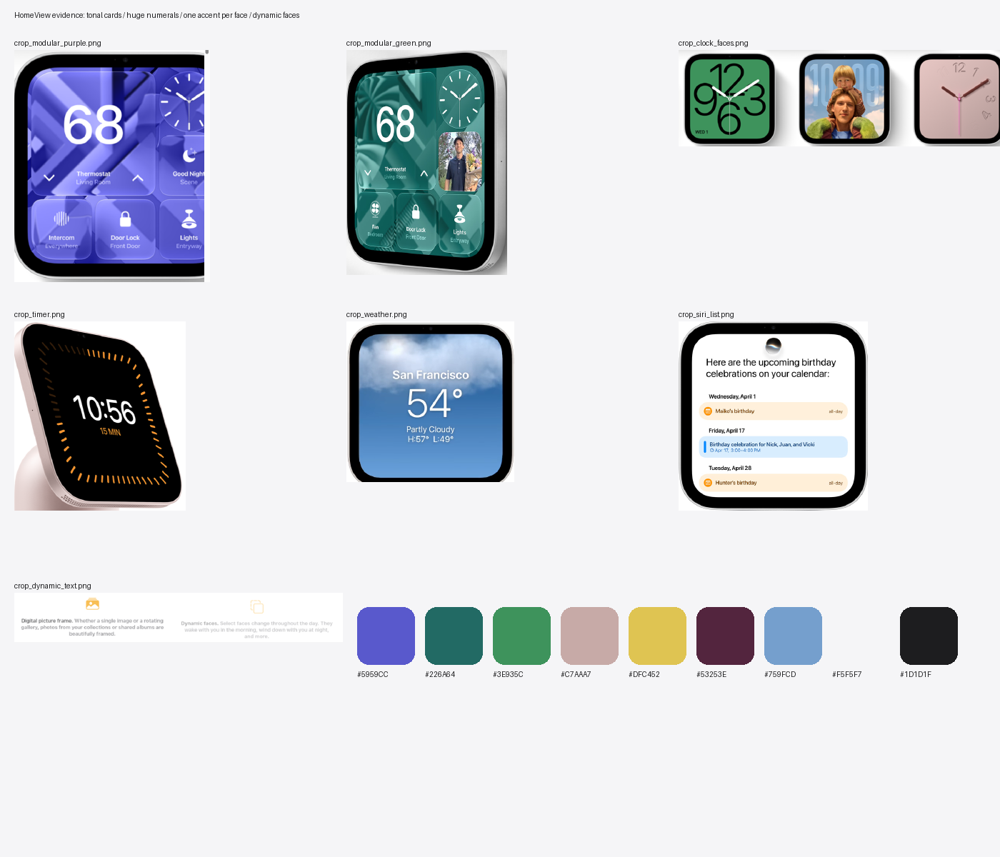

*HomeView 官网截图证据汇总（取色来源）*
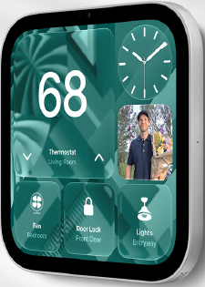

*Modular 绿：同色相明暗卡片*
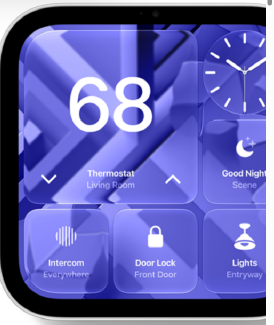

*Modular 紫*
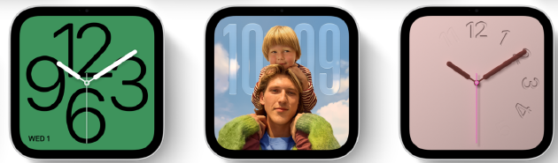

*表盘合集*
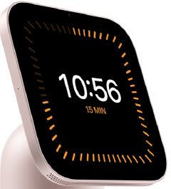

*计时：黑底 + 单一橙色*
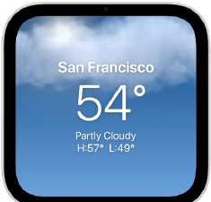

*天气：大数字 + 4 行字*
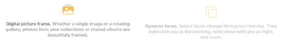

*随时间变化的表盘*
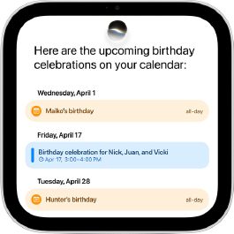

*Siri 列表*
## 最终效果图（目标）

以下 v3 是<b>目标效果</b>，均为 466 圆屏实际渲染（LVGL 原型，带圆形遮罩），全分辨率 PNG 在 <code>mockups/v3-final/</code>。

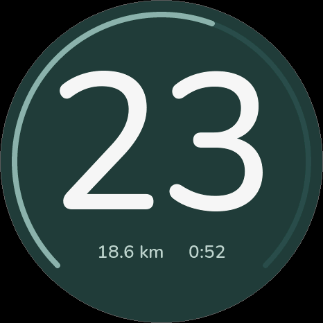

*码表 · 白天*
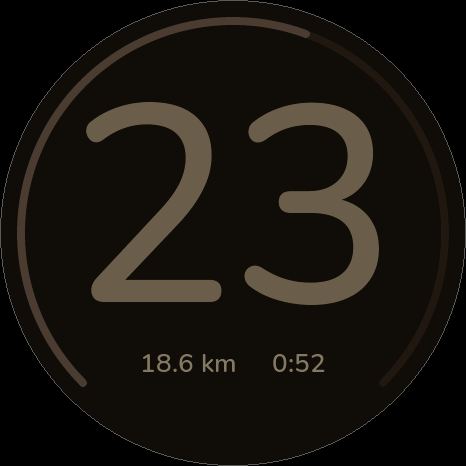

*码表 · 夜间*
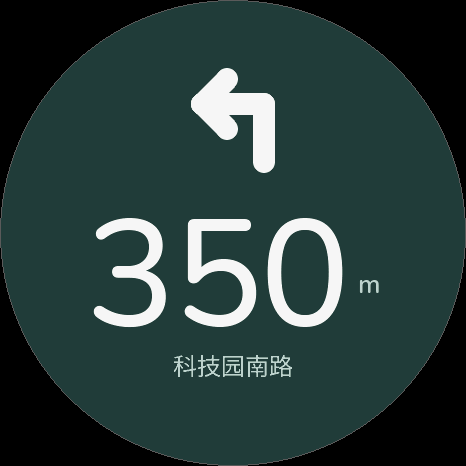

*导航 · 白天*
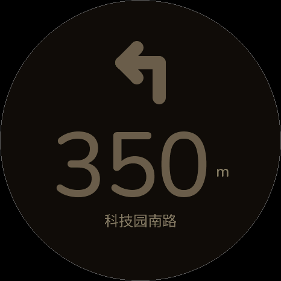

*导航 · 夜间*
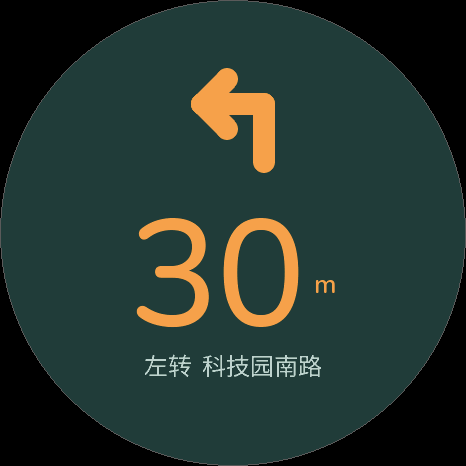

*导航 · 马上转弯 · 白天*
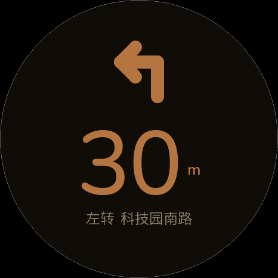

*导航 · 马上转弯 · 夜间*
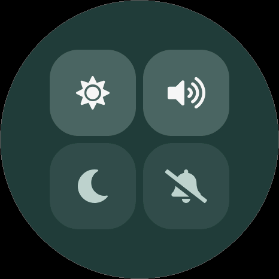

*控制中心 · 白天*
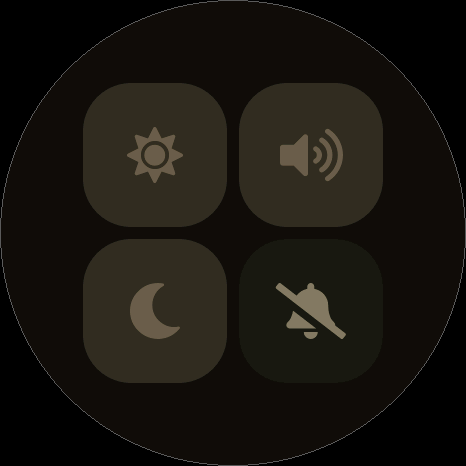

*控制中心 · 夜间*
### 边界用例：1/2/3 位数、km/m 切换

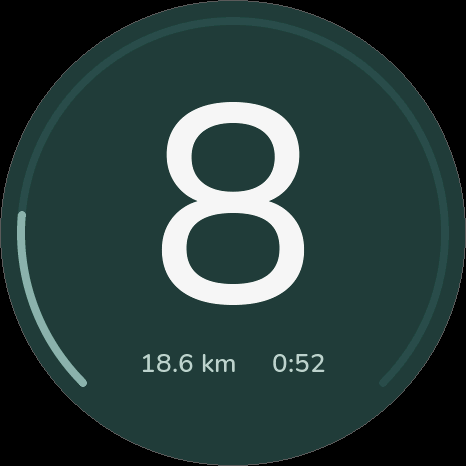

*边界用例 ride_1digit_day*
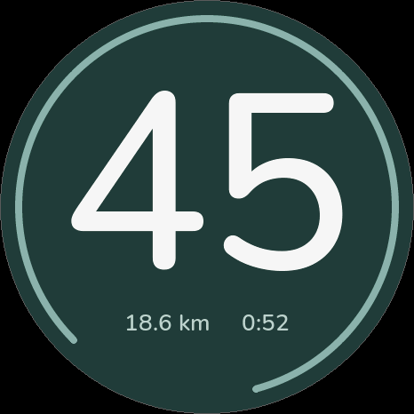

*边界用例 ride_45_day*
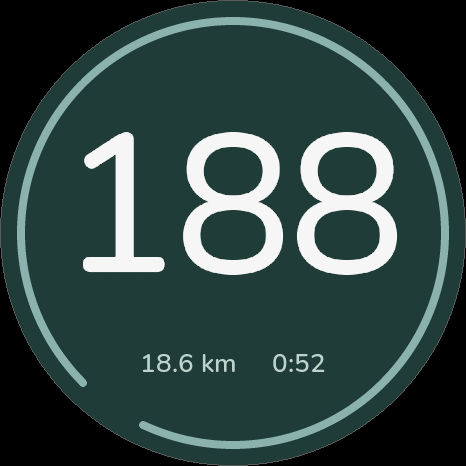

*边界用例 ride_188_day*
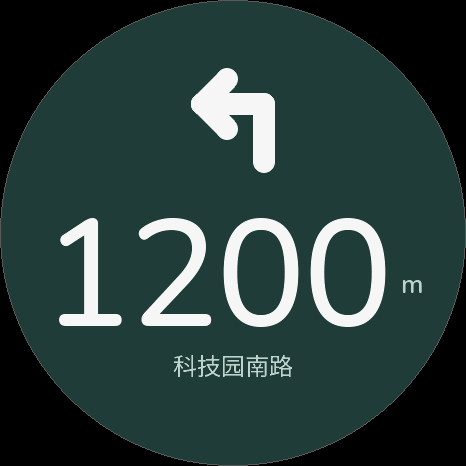

*边界用例 nav_1200_day*
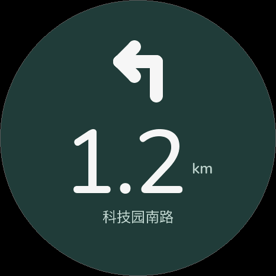

*边界用例 nav_1.2km_day*
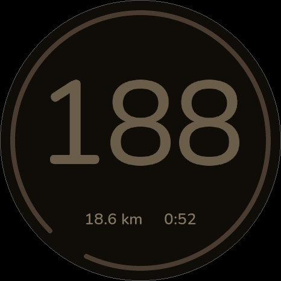

*边界用例 ride_188_night*
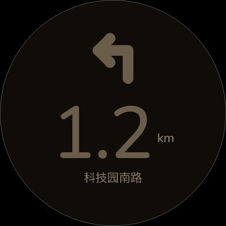

*边界用例 nav_1.2km_night*
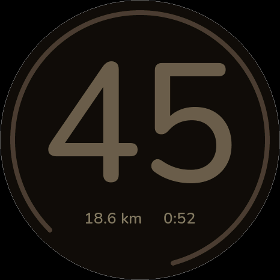

*边界用例 ride_45_night*
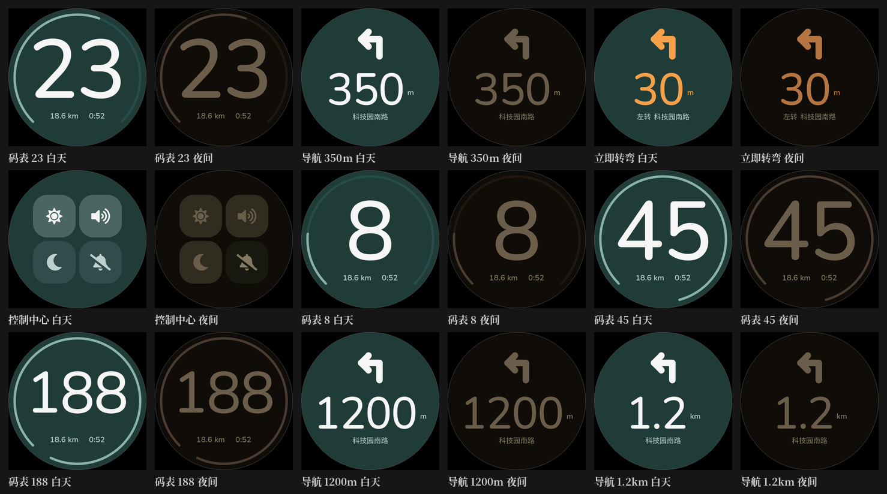

*v3 contact sheet*
### 迭代历史 R1→R5

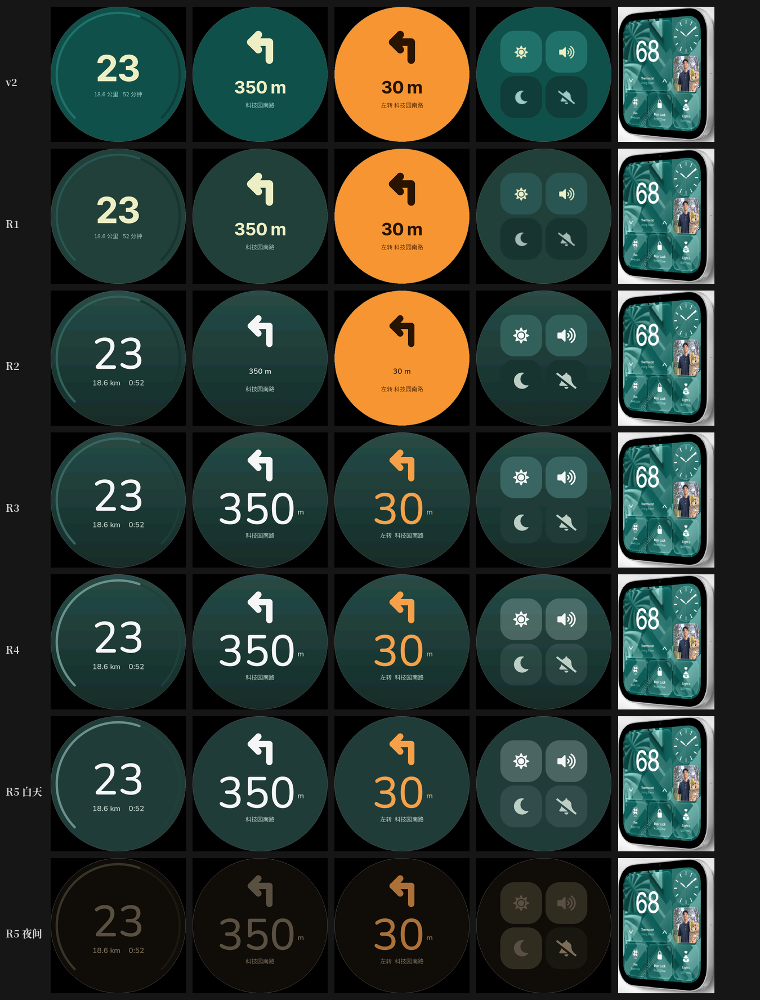

*v3 R1–R5 迭代：饱和度下调、主数字改纯白圆体、转弯只染箭头与数字、去渐变*
### 待机矢量数字（已在固件里，模拟器截图）

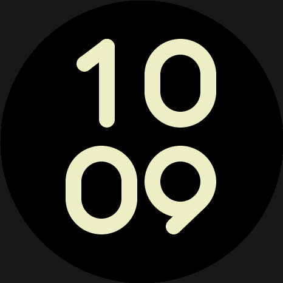

*待机 · 白天*
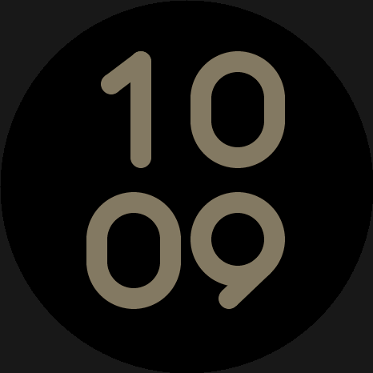

*待机 · 夜间*
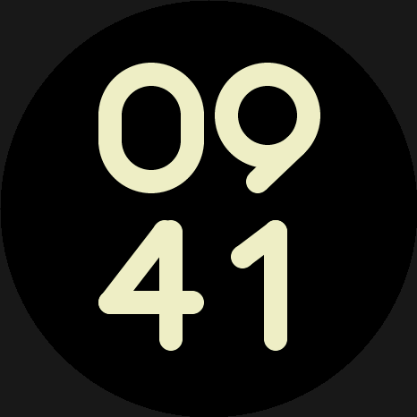

*待机 · 防烧屏位移*
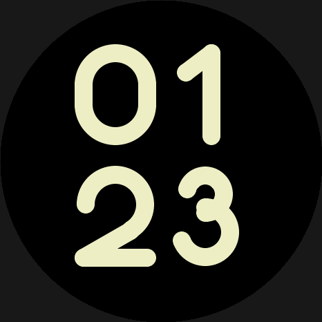

*矢量数字 0–3*
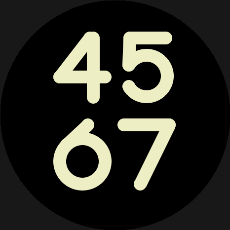

*矢量数字 4–7*
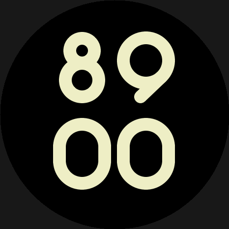

*矢量数字 8/9 直尾与弯尾*
### v1 全页面版式参考

<b>v1 layout reference for pages not yet redone in v3 (standby, to-do, Grok states, empty states); restyle them per v3 rules.</b> 这些页面只参考信息结构，视觉一律按 v3 规则重做。

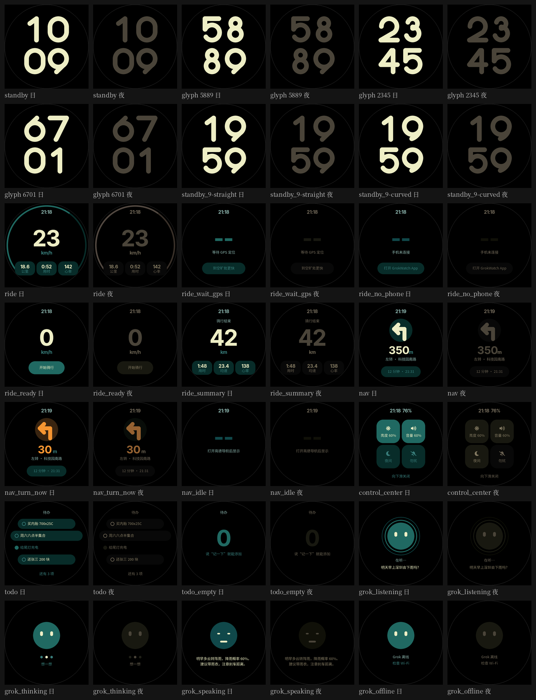

*v1 全页面（旧风格，仅版式参考）*
## 设计 Token 与规则（精确值）

| Token | 白天 | 夜间 |
|---|---|---|
| 底色 bg | #213F3B（H172 S0.31 L0.19） | #100D0A（L0.05） |
| 主数字 / 主文字 | #F4F6F2 纯白圆体 100% | 暖白 #FFE8C8，整体亮度 25–35% |
| 辅助行 | 白色约 55–60% 透明度 | 暖白约 45%（已从过暗调亮） |
| 瓷砖 开 / 关 | 白色叠加 23% / 8% | 暖白叠加，同比例 |
| 待机数字 | 薄荷 #E8EFC4 | 压暗暖白 |
| 强调色 | #F7A04A，仅马上转弯的箭头和数字 | 同色压暗；无蓝无红 |
### 字体与字号

- 主数字：<b>Nunito Medium 280px</b>（码表速度，约屏高 40%）/ <b>150px</b>（导航距离等）。OFL 授权，与矢量待机数字同一圆体语言。
- 辅助行：26px（同字族拉丁字母，例 <code>18.6 km 0:52</code>）。
- 中文：街道名等 <b>20px</b>（v3 原型用了 24px，但 24px 中文要 +95KB，固件定为 20px）。
- 字号成本：Nunito 子集压缩约 50KB。

### 版面与形状

- 圆角：卡片 28，瓷砖 36，胶囊 = 全圆（高度/2）。
- <b>每页一个主角 + 一行辅助</b>，去掉顶部时间、底部提示、多卡片。
- 圆屏安全区：内容半径 ≤215（速度环 r216，瓷砖角距圆心 ≤221）。
- 纯色底，不用渐变（RGB565 会色带，也省渲染）。
- 三位数自动缩到 70%；距离 ≥1000m 切 km（1.2 km），否则 m；单位小字贴在数字右下。
- 码表不写 km/h；心率先从主屏拿掉。
- 控制中心：四个大图标块，开亮一级、关暗一级。

### 动效

- 左右翻页：横向滑入（140px 位移 / 240ms，从手指方向进入，ease-out 收尾）；帧率连续两次 &lt;30fps 就改直接切换。
- 通用：页面切换约 280ms，cubic-bezier(0.32,0.72,0,1)；按下缩放 0.96 / 100ms。

### 空间预算

OTA 槽 ota_0/ota_1 各 0x3f0000 = <b>4,128,768 B</b>。当前约 <b>80%</b>，目标 <b>≤75%</b>。每加一个字号/字体都要先算账。

## 固件现状与代码地图

分支 <code>feat/standby-clock</code>，HEAD <code>6549020</code>（2.6.4：NVS 启动记录、字体改回不压缩、滑动帧率降级、Grok 仅中心长按、USB 测试通道、触摸日志）。前一个提交 <code>e43a445</code>（2.6.3 横向翻页）。补丁见 <code>firmware-patch/</code>（de4229d 之后 5 个提交）。2.6.4 还<b>没有上真机</b>。

| 路径（main/boards/m5stack/stopwatch/） | 作用 |
|---|---|
| gw_ultra.c | 各页面/表盘（码表、导航、控制中心、待办、Grok） |
| gw_standby_* | 待机矢量数字 |
| nav_ui.cc | 导航 UI 与页面切换 |
| gw_model.c/.h | 导航/骑行数据模型（8 个已修 bug 都在这里有测试） |
| gw_health.c / gw_health_esp.cc | OTA 自检与回滚：≥30s、UI tick ≥20、heap ≥24KB 才标记有效，120s 未达标则回滚 |
| gw_console.cc | USB 测试通道（仅 GW_TEST_CONSOLE 构建）：左滑/右滑/点击命令，回报 fps/内存/触摸/重启原因 |
| gw_input.c/.h | 触摸手势判定；Grok 只在刻意的中心长按触发 |
| gu_*.c, gz_20.c | 字体（2.6.4 改回不压缩） |
| sim/ | LVGL 主机模拟器（build.sh, sim.c, mkimg.py） |
| test/run.sh | 主机单元/性质测试 |
| docs/BUILD.md | 可复现构建说明 |
### 原型源码（prototype/）

- <code>final.c</code>：v3 最终版渲染（R5 token + Nunito 280/150、辅助 26、中文 24）。
- <code>v3.c</code>、<code>v3_fonts/hv_*.c</code>：v3 迭代版与字体。
- <code>hv_nav.c hv_ride.c hv_sec.c hv_zh24.c</code>：final 用的字体。
- <code>proto.c</code>、<code>sheet.py</code>、<code>rounds.py</code>：v1 原型与拼图脚本。

### 构建与模拟器

```sh
. ~/esp/esp-idf/export.sh          # ESP-IDF v6.1.0
idf.py -B build -D SDKCONFIG=sdkconfig.ble build
sh main/boards/m5stack/stopwatch/test/run.sh
PYTHON=python3 sh main/boards/m5stack/stopwatch/sim/build.sh /tmp/simout
```

模拟器需要 32 位 multilib（-m32）、python3 + Pillow，以及 idf.py 拉好的 managed_components/。自己的 OTA 地址放在 git-ignored 的 <code>sdkconfig.private</code>，不要提交。

## 状态表

只用四种状态：已写代码 / 已过自动测试 / 已过模拟器 / 已过真机。

| 事项 | 状态（已写代码 / 已过自动测试 / 已过模拟器 / 已过真机） |
|---|---|
| 导航/模型 8 个 bug 修复 | 已过自动测试 |
| 待机矢量数字 | 已过模拟器 |
| 横向翻页动画 | 已过模拟器（真机上 2.6.3 未能稳定运行） |
| HomeView v3 主题 | 仅原型，尚未写入固件 |
| 昼夜自动切换（日出日落） | 尚未写代码 |
| 2.6.4 启动记录/USB 测试通道/Grok 防误触 | 已写代码（部分有主机测试），未上真机 |
## 已知问题

- <b>真机启动后重启</b>：2.6.2、2.6.3 OTA 后约 20–30 秒内重启，回滚到 RC6（2.5.3），服务器又重新下发，形成 OTA 循环（OTA 目录已清空停止）。根因未知，怀疑压缩字体 + 堆压力、或看门狗。2.6.4 加了 NVS 启动记录来抓重启原因。
- Sunny 反馈整体卡顿（可能与循环升级有关，未确认）。
- Grok 容易被误触触发（2.6.4 改为仅中心刻意长按，未上真机验证）。
- 手表当前运行 RC6（2.5.3）。
- OTA 回滚只在主机逻辑测试过，真机未验证；QEMU 不支持八线 PSRAM。
- 固件占槽约 80%，需瘦身到 ≤75%。

## 给 Codex 的硬规则

- <b>不经 Sunny 同意，不刷机、不推 OTA（不往 data/bin 放 bin）、不推 GitHub、不发布。</b>
- 永不提交 Wi‑Fi 凭证、内网 IP（sdkconfig.private 已 git-ignore）、keystore、token。
- 任何真机推送之前，先给 Sunny 看模拟器效果图。
- 先写测试再修；每项标注四种状态之一。
- 每个版本报告真实的 fps、内存、OTA 槽占用，不编数字。
- 汇报结构：修复与根因 / 测试用例与结果 / 真机验证 / 未解决 / 提交号与产物。
- 自审发现的问题先改完再给 Sunny 看。

## 本报告使用的 skill

frontend-design、apple-design、taste-minimalist。配色取自 HomeView 研究（深灰青绿 #213F3B、薄荷 #E8EFC4、暖白）。

